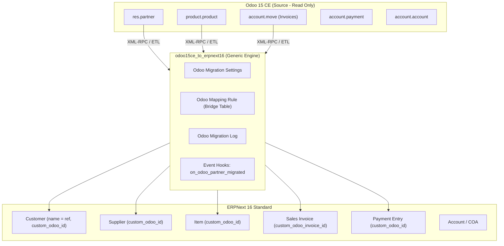

# Odoo 15 CE to ERPNext 16 Migration Blueprint & Roadmap

## 1. Executive Summary & Architecture

The objective of this project is to provide a reliable, modular, and non-invasive migration framework from **Odoo 15 Community Edition** to **ERPNext 16**.

### Architecture Strategy: Hybrid Linking (Direct Indexed Fields + Mapping Table)
Rather than choosing strictly between custom fields or separate mapping DocTypes, we use a **Hybrid Approach**:
1. **Direct 1:1 Fast Lookup (`custom_odoo_id`, `custom_odoo_ref`)**:
   - Placed directly on standard target DocTypes (`Customer`, `Supplier`, `Item`, `Sales Invoice`, `Payment Entry`).
   - Indexed and rapid for high-volume transactions (~56k invoices).
2. **Dedicated Bridge Table (`Odoo Mapping Rule`)**:
   - Resolves **M:1 duplicates** (e.g. historical duplicate Odoo products consolidated into a single ERPNext Item).
   - Replaces fragile comma-separated strings (`"470,512"`) with structured, searchable mapping rules.
   - Maps non-entity masters such as Chart of Accounts, GST/TNVAT taxes, Journals, and Payment Methods.
3. **Decoupled Application Layer**:
   - **`odoo15ce_to_erpnext16`**: 100% agnostic, open-source migrator targeting standard ERPNext models.
   - Emits standard Frappe hooks (`on_odoo_partner_migrated`) to allow external or domain apps to react if needed.

---

## 2. Review of Existing Links & Data Models

### 2.1 Customer & Member Linking
- **ERPNext Customer Naming Pattern:** `Customer.name` is systematically set to `res.partner.ref` (e.g. member numbers).
- **Audit Findings:**
  - **720 out of 798 Odoo partners** already match existing ERPNext `Customer` records 1:1 on `name == ref`.
  - Added and populated `custom_odoo_id` and `custom_odoo_ref` directly on `Customer` for idempotent two-way tracking.
  - **Duplicate `ref` in Odoo:** In Odoo, `ref = '1'` was assigned to 4 distinct corporate/institutional entities.
  - **Partners without `ref` (39 records):** Includes internal users (Administrator, POS User), utility boards, departments, and suppliers.

### 2.2 Item Linking & Multi-ID Consolidation
- In ERPNext `Item`, the field `custom_odoo_item_id` tracks linked Odoo `product.product.id`.
- **Current State:**
  - **321 Items** currently exist in ERPNext.
  - **289 Items** are linked to Odoo IDs.
  - **18 Items** have comma-separated CSV values (e.g., `Tennis Old Ball` $\rightarrow$ `"470,512"`; `Rail Coach` $\rightarrow$ `"442,279,267"`). These represent items that were duplicated across historical seasons or departments in Odoo, consolidated into a single clean catalog item in ERPNext.
  - **39 Items** have `custom_odoo_item_id_small` (specifically for Bar items where a peg / unit was tracked as a separate product in Odoo).
  - Across all 321 ERPNext items, **344 unique Odoo product IDs** are cleanly linked.
  - **173 Odoo products** remain unlinked (primarily Canteen specials, Club venue packages, and office event items).

### 2.3 Sales Invoices Linking
- In ERPNext `Sales Invoice`, the field `custom_odoo_invoice_id` tracks `account.move.id`.
- **Current State:**
  - **8,148 Sales Invoices** exist in ERPNext.
  - **3,246 Sales Invoices** are already linked with their corresponding `custom_odoo_invoice_id`.

---

## 3. Progress Tracker & Deployment Status

| Phase | Description | Dev Machine | Prod Server | Status |
| :--- | :--- | :---: | :---: | :---: |
| **Phase 1** | App scaffolding & Git repository creation | Completed | Completed | **Done** |
| **Phase 1.1**| DocTypes created (`Settings`, `Mapping Rule`, `Log`) | Installed | Installed | **Done** |
| **Phase 1.2**| `Odoo Migration Settings` configured & tested | Connected (UID 2) | Connected (UID 2) | **Done** |
| **Phase 2.1**| Partner-to-Customer 1:1 linking (`name == ref`) | 720 Linked | Ready to run | **Done on Dev** |
| **Phase 2.2**| Suppliers extraction | Mapped | Pending | In Progress |
| **Phase 2.3**| Duplicate ref=1 institutional customer resolution | Mapped | Pending | In Progress |
| **Phase 3.1**| Comma-separated CSV item IDs streamlined into `Odoo Mapping Rule` | Implemented | Pending | In Progress |
| **Phase 3.2**| Clarification / Review of 173 unlinked items | Pending input | Pending input | Pending |
| **Phase 4** | Chart of Accounts, Taxes & Journals mapping | Defined | Pending | Scheduled |
| **Phase 5** | Historical Sales Invoices & Payments batch sync | Planned | Planned | Scheduled |

---

## 4. Environment & Deployment Details

- **Installed App:** `odoo15ce_to_erpnext16` (cloned from GitHub)
- **Settings Status:** **Connected** (XML-RPC to local Odoo 15)
- **Zero updates were made to Odoo database or existing DocTypes on production.**

### 4.1 Deployment Automation (Docker Image Persistence)
- Added `odoo15ce_to_erpnext16` to `apps.json` on the production host.
- When `deploy.sh` is executed in the future, the Docker build script encodes `apps.json` via `--build-arg APPS_JSON_BASE64` to bake `odoo15ce_to_erpnext16` into the custom image, ensuring the app and its dependencies persist across rebuilds and deployments.
